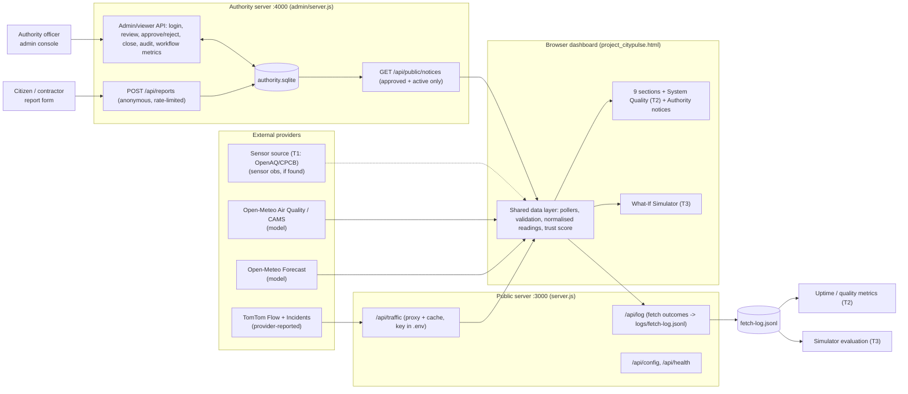

# CityPulse Architecture

## Data classes shown on screen
| Class | Source | Example |
|---|---|---|
| Sensor observation | measured sensor feed | (only if T1 finds one) |
| Provider-reported | TomTom values/incidents | speeds, incident reports |
| Model estimate | Open-Meteo, CAMS | temperature, PM2.5, US AQI |
| Derived | formula on the above | congestion %, trust score |
| Authority-verified | approved by the authority server | planned works, verified incidents |
| Scenario projection | simulator | projected congestion |
| Unavailable | no source | noise, crowd, transit |

## Evidence ladder for incident wording
Slow-down alone → "Heavy traffic — no incident reported". "Accident" only if TomTom reports one nearby (1 km) or an authority-approved report exists. Approved planned works on the road → "Planned work — avoid".

## Team ownership map
| Component | Owner |
|---|---|
| `server.js`, data layer, CI, trust score, deploy | Lead |
| `admin/` backend, `config.json`, `DATA_SOURCES.md`, sensor/transit sources | T1 |
| System Quality section, GQM, metrics, tests | T2 |
| Simulator, Analytics, `scripts/evaluate-simulator.js` | T3 |
| `admin/report.html`, `admin/admin.html`, notices panel UI, accessibility, PPT, demo | T4 |
